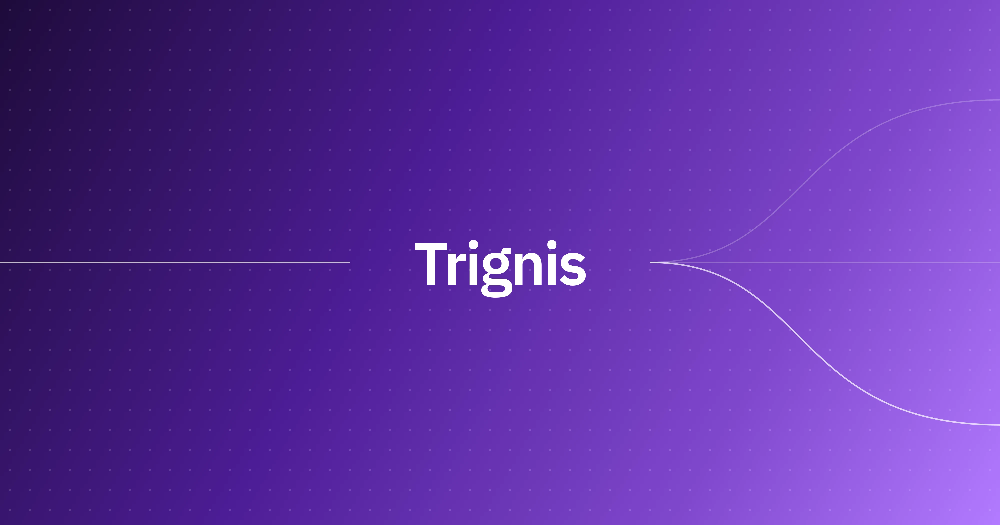
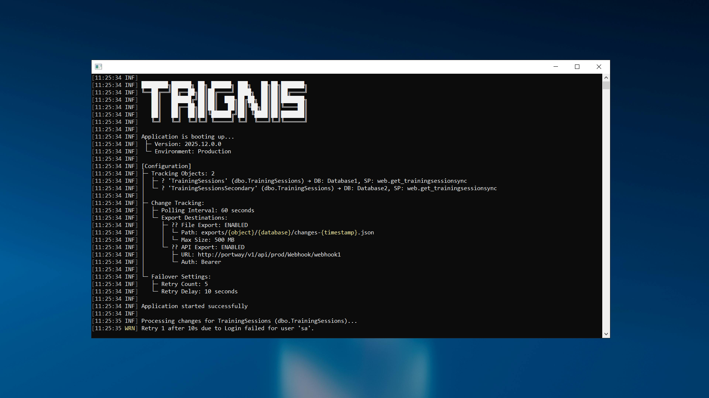

[](LICENSE)
[](https://github.com/melosso/trignis/commits/main)
[](https://github.com/melosso/trignis/releases/latest)

Trignis is a lightweight service that exports database table changes.

- Documentation: [Github Pages](https://melosso.github.io/trignis/)
- Deploy: [Install Trignis](#getting-started)

Trignis reads changes from SQL Server or PostgreSQL. Trignis sends each change to a file, an HTTP endpoint, or a message queue.

## What is Trignis?

Trignis connects a database to the systems that consume its changes. Use cases: data synchronization, audit trails, ETL processes and application integration.

#### **How it works**
- Polls each tracked object on an interval. The default interval is 30 seconds.
- Exports the final state of a row once per interval. Intermediate writes are not exported.
- Reads changes through a stored procedure that you write. The stored procedure defines the payload.
- Stores failed exports in a dead letter store (`sinkhole.db`). Retries each failed export 5 times by default. The dashboard replays or discards the remaining exports.

#### **Key features**

- Databases: **SQL Server** and **PostgreSQL 13+**
- Destinations: files, HTTP endpoints and message queues
- Dashboard for environments, tracked objects, dead letters and logs
- One configuration file per environment, loaded without a restart
- Encrypted configuration
- Pause controls per environment and per object

## Getting Started

Trignis supports two deployment methods: Docker Compose and Windows Server.

### Docker Compose (Recommended)

The setup script creates `environments/` and `appsettings.json`, then starts the container:

```bash
sh -c "$(curl -fsSL https://raw.githubusercontent.com/melosso/trignis/refs/heads/main/docker-setup.sh)"
```

Manual setup: use the included [docker-compose.yml](docker-compose.yml).

The dashboard is available at **http://localhost:2455**.

### Windows (Server)

Download the latest release from [Releases](https://github.com/melosso/trignis/releases) and extract it to your deployment folder.

1. **Install the .NET 10 Runtime and the ASP.NET Core 10 Runtime.** Trignis requires both. The ASP.NET Core Runtime package does not include the .NET Runtime:

```powershell
winget install --id Microsoft.DotNet.Runtime.10 -e
winget install --id Microsoft.DotNet.AspNetCore.10 -e
```

2. **Store the encryption key** as a machine environment variable:

```powershell
$bytes = New-Object byte[] 48; [Security.Cryptography.RandomNumberGenerator]::Create().GetBytes($bytes); [Environment]::SetEnvironmentVariable("TRIGNIS_ENCRYPTION_KEY", [Convert]::ToBase64String($bytes), "Machine")
```

3. **Install and start the service:**

```powershell
sc.exe create "Trignis (Agent)" binPath= "C:\trignis\Trignis.exe" start= auto
sc.exe start "Trignis (Agent)"
```

4. Open **http://localhost:2455** (dashboard).

Back up the encryption key. A lost key makes the encrypted configuration unrecoverable. Recovery: delete `.core/` and enter every secret again.

## Configure

Each file in `environments/` defines one environment. An environment file contains connection strings, tracked objects and destinations:

```json
{
  "ConnectionStrings": {
    "PrimaryDatabase": "Server=prod-sql.company.com;Database=PrimaryDB;Trusted_Connection=True;"
  },
  "ChangeTracking": {
    "ExportToFile": true,
    "TrackingObjects": [
      {
        "Name": "Orders",
        "Database": "PrimaryDatabase",
        "TableName": "dbo.Orders",
        "StoredProcedureName": "dbo.sp_GetOrderChanges"
      }
    ]
  }
}
```

Trignis loads new and changed environment files without a restart. The `Provider` setting selects the database: `mssql` (default) or `postgres`.

Each tracked object requires a stored procedure that returns a specific JSON structure. The [stored procedure contract](https://melosso.github.io/trignis/reference/stored-procedure) defines the structure.

The [documentation](https://melosso.github.io/trignis/) describes database preparation, the first tracked table and destination settings.

## Risks

Change capture adds write cost and stored data on the source database. Read this section before enabling change capture on a production database.

**SQL Server change tracking**

- Writes on tracked tables are roughly 5–10% slower.
- Change tracking side tables grow and require regular cleanup.
- SQL Server 2025 (17.x) and later use an adaptive shallow cleanup for large side tables. Earlier versions use a deep cleanup.
- `sp_flush_CT_internal_table_on_demand` requires a manual run. Trignis does not run it.
- Compatibility with older SQL Server versions is not guaranteed.
- References: [About Change Tracking](https://learn.microsoft.com/en-us/sql/relational-databases/track-changes/about-change-tracking-sql-server?view=sql-server-ver17) and [KB3173157](https://support.microsoft.com/en-us/topic/kb3173157-adds-a-stored-procedure-for-the-manual-cleanup-of-the-change-tracking-side-table-in-sql-server-2fe76677-8687-acc0-12a9-78f3709fc621).

**PostgreSQL outbox tables**

- A row trigger runs inside every write. The trigger cost is added to the writing transaction.
- The outbox table grows until you trim it. Trignis does not trim the outbox table.
- Trim rows below the watermark that the dashboard displays. Do not trim rows above the watermark.
- Long-running transactions delay changes. Delayed changes arrive in bursts and are not lost.

Change tracking and outbox tables are optional. Any column that increases and is assigned at commit or later is a valid watermark on both platforms.

## Preview



## License

Trignis is licensed under the **EUPL 1.2**. See [LICENSE](LICENSE).

## Contributing

Submit issues and pull requests with the provided templates.
